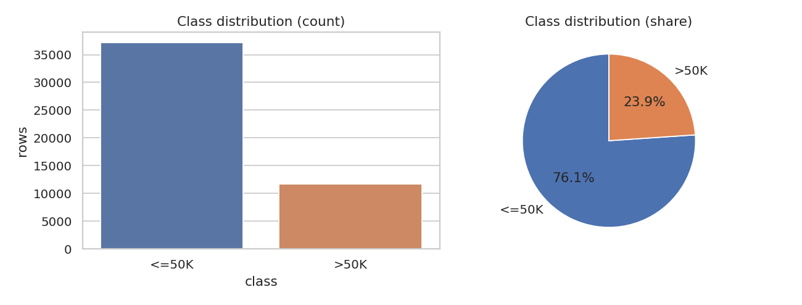
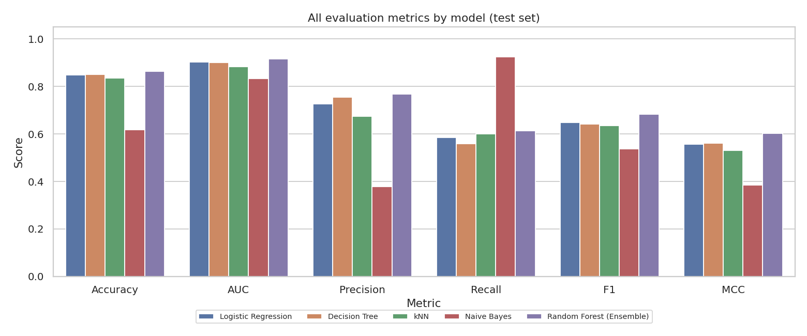
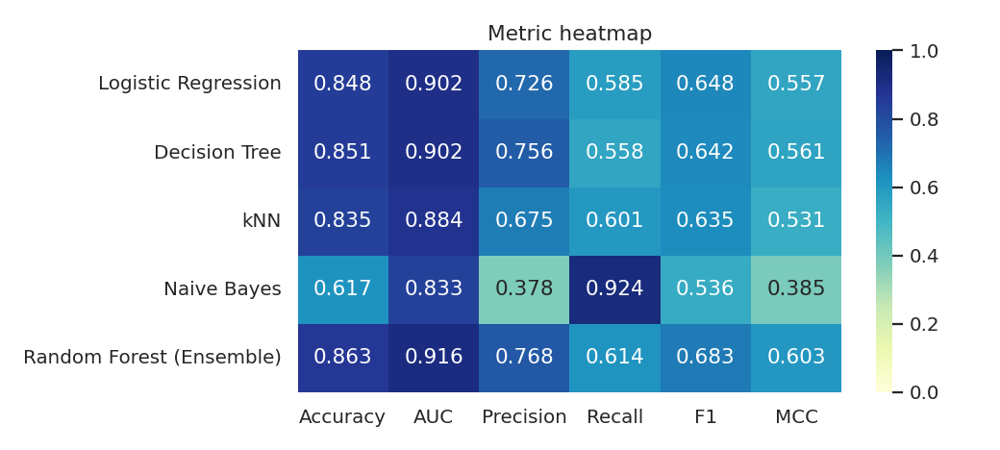
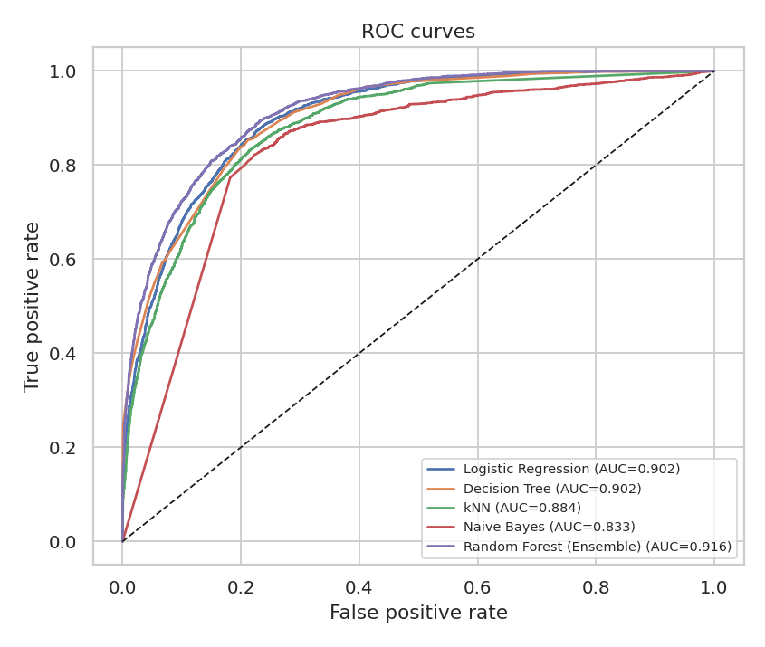
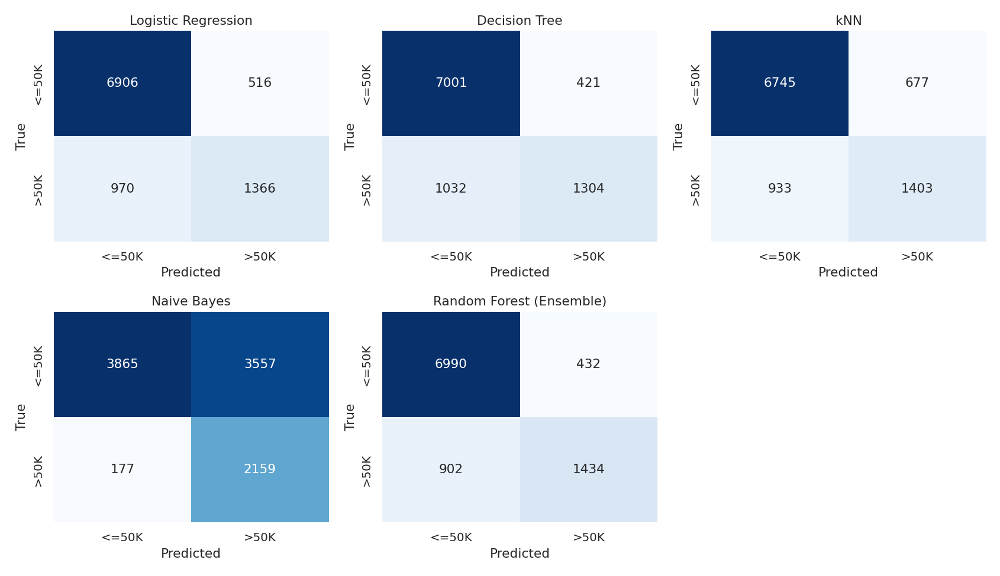

# Classification Models Comparison - ML Assignment 2

**Student:** NAITIK CHATTERJEE | **BITS ID:** 2026CT05027

## 1. Problem statement
Build and compare five machine-learning classifiers (Logistic Regression, Decision Tree, kNN, Naive Bayes and Random Forest) on one public dataset, and evaluate them with Accuracy, AUC, Precision, Recall, F1 and MCC. The task is binary classification: predict whether a person's yearly income is above 50K USD ('>50K') from census attributes.

## 2. Dataset description
- **Source:** UCI Adult Census Income, loaded via OpenML (data id 1590)
- **Why chosen:** mixed numeric and categorical features, real missing values, and a clear class imbalance make the comparison of metrics meaningful.
- **Instances:** 48,842 rows (48,790 after removing 52 duplicates) | **Features:** 14 | **Target:** `class` (<=50K, >50K)
- **Class distribution:** <=50K: 37,155 (76.07%), >50K: 11,687 (23.93%) (imbalance ratio 3.18:1)
- **Missing values:** 6465 cells in 3 columns (workclass, occupation, native-country), imputed inside the pipeline.

| Feature type | Count | Features |
|---|---|---|
| Numeric | 6 | age, fnlwgt, education-num, capital-gain, capital-loss, hours-per-week |
| Categorical | 8 | workclass, education, marital-status, occupation, relationship, race, sex, native-country |



### Preprocessing
1. Duplicate rows removed (52).
2. Missing values imputed: median for numeric, most frequent for categorical.
3. Categorical features one-hot encoded; numeric features standardised.
4. Stratified 80:20 train-test split (39,032 / 9,758) with random seed 42.
5. Every preprocessing step lives inside a scikit-learn `Pipeline`, so it is fitted on the training data only.

## 3. GitHub repository link
https://github.com/2026ct05027-max/ml-assignment-2-classification

```
project-folder/
|-- requirements.txt
|-- README.md
|-- test_data.csv
|-- model/   (notebook + saved models: *.joblib)
```

## 4. Models used
Model configurations:

- **Logistic Regression:** C=1.0, max_iter=1000, random_state=42
- **Decision Tree:** max_depth=8, min_samples_leaf=20, random_state=42
- **kNN:** n_neighbors=15, weights=distance
- **Naive Bayes:** var_smoothing=1e-09
- **Random Forest (Ensemble):** max_depth=None, min_samples_leaf=2, n_estimators=300, random_state=42

### Comparison table (test set)
| ML Model Name | Accuracy | AUC | Precision | Recall | F1 | MCC |
|---|---|---|---|---|---|---|
| Logistic Regression | 0.8477 | 0.9020 | 0.7258 | 0.5848 | 0.6477 | 0.5572 |
| Decision Tree | 0.8511 | 0.9016 | 0.7559 | 0.5582 | 0.6422 | 0.5610 |
| kNN | 0.8350 | 0.8842 | 0.6745 | 0.6006 | 0.6354 | 0.5307 |
| Naive Bayes | 0.6173 | 0.8329 | 0.3777 | 0.9242 | 0.5363 | 0.3855 |
| Random Forest (Ensemble) | 0.8633 | 0.9159 | 0.7685 | 0.6139 | 0.6825 | 0.6029 |






### Observations
| ML Model Name | Observation about model performance |
|---|---|
| Logistic Regression | Accuracy 0.848, AUC 0.902, F1 0.648, MCC 0.557 (rank 3 of 5 by MCC). Precision (0.726) is higher than recall (0.585), so it is cautious about predicting '>50K' and misses some true cases. Training accuracy (0.846) is close to test accuracy, so it generalises well. It learns one linear decision boundary on the scaled and one-hot encoded features, so it is fast and stable but cannot capture feature interactions. |
| Decision Tree | Accuracy 0.851, AUC 0.902, F1 0.642, MCC 0.561 (rank 2 of 5 by MCC). Precision (0.756) is higher than recall (0.558), so it is cautious about predicting '>50K' and misses some true cases. Training accuracy (0.862) is close to test accuracy, so it generalises well. A single tree (depth limited to 8) captures non-linear rules and interactions and is easy to interpret, but one tree is high-variance and sensitive to the training sample. |
| kNN | Accuracy 0.835, AUC 0.884, F1 0.635, MCC 0.531 (rank 4 of 5 by MCC). Precision (0.675) is higher than recall (0.601), so it is cautious about predicting '>50K' and misses some true cases. Training accuracy (1.000) is clearly above test accuracy, which indicates overfitting. It classifies by the 15 nearest training points, so it depends on feature scaling and loses discriminative power in a high-dimensional one-hot space; it also has to compare every test row with all training rows at prediction time. |
| Naive Bayes | Accuracy 0.617, AUC 0.833, F1 0.536, MCC 0.385 (rank 5 of 5 by MCC). Recall (0.924) is higher than precision (0.378), so it finds most '>50K' cases but with more false alarms. Training accuracy (0.619) is close to test accuracy, so it generalises well. Gaussian Naive Bayes assumes independent, normally distributed features; one-hot columns are neither, so its probability estimates are often less reliable than those of the other models. |
| Random Forest (Ensemble) | Accuracy 0.863, AUC 0.916, F1 0.683, MCC 0.603 (rank 1 of 5 by MCC). Precision (0.768) is higher than recall (0.614), so it is cautious about predicting '>50K' and misses some true cases. Training accuracy (0.902) is close to test accuracy, so it generalises well. Averaging 300 decorrelated trees reduces the variance of a single tree and captures non-linear interactions, which typically gives the most robust results on tabular data. |

**Overall winner for this dataset:** Random Forest (Ensemble) is the overall winner on this dataset: it ranks first by MCC (0.603, AUC 0.916) and is the best model on 5 of 6 metrics; the runner-up is Decision Tree (MCC 0.561). Because the classes are imbalanced (23.9% minority class), accuracy alone is optimistic, so MCC and AUC were used as the main criteria.

## 5. How to run
```
pip install -r requirements.txt
jupyter notebook model/ML_Assignment_2.ipynb     # Run All
```
The notebook downloads the dataset, trains the five models, prints the metrics, draws the graphs and rewrites this README, `test_data.csv` and the saved models.
